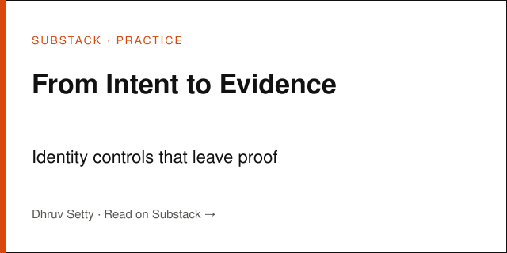
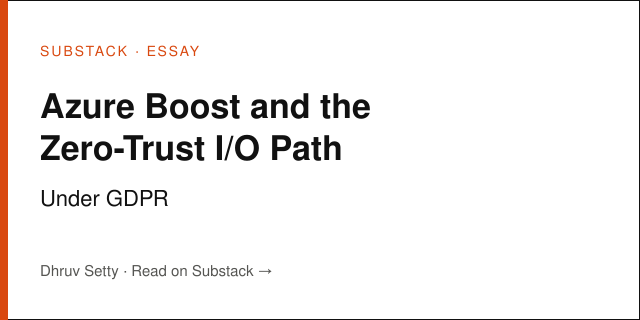

### Dhruv Setty

**IT Support & Identity Administration · Level 1 Service Desk · Auckland, NZ**

Open to service desk, IT support and IAM/IGA roles in Auckland.

#### About me

Level 1 service desk analyst in Auckland. I log, prioritise and resolve incidents and requests in ServiceNow to agreed SLAs, following ITIL incident, request and escalation practice, and support Microsoft 365 users with accounts, access, passwords and onboarding.

I come from identity-sensitive roles: KYC and AML/CFT checks in retail banking, and patient identity reconciliation under the Health Information Privacy Code. That work is why I verify before I change anything, and why I am building towards Identity and Access Management (IAM) and Identity Governance and Administration (IGA).

#### Current focus

- Resolving more identity tickets at first contact: unlocks, resets, MFA re-registration, licensing and access requests.
- Building depth in IAM and IGA: joiner, mover and leaver processes, least-privilege access, access reviews and audit-ready controls.
- Growing from the service desk into an IAM or IGA analyst role.

#### How I work a ticket

1. **Verify** the caller before any account change.
2. **Log and categorise** so the queue, SLA and reporting are right from the start.
3. **Resolve at first contact** where the knowledge base allows.
4. **Escalate cleanly** with symptoms, steps tried and user impact.
5. **Close the loop** with the user and update the knowledge base.

  <picture>
    <source media="(prefers-color-scheme: dark)" srcset="assets/skills-hexagon-dark.svg">
    
  </picture>

#### Identity projects

| Project | Relevance to the desk |
| --- | --- |
| [Read-only Entra ID and Graph exports](https://github.com/dhruv-setty/read-only-entra-id-and-graph-exports) | Answers "who has access to what" from a read-only export, without changing the tenant. |
| [Entra ID sign in for Debian with SSSD](https://github.com/dhruv-setty/entra-id-sign-in-for-debian-with-sssd) | Shows how a disabled account loses server access, so users get accurate timing. |
| [Identity governance for legacy Linux file shares](https://github.com/dhruv-setty/identity-governance-for-legacy-linux-file-shares) | Starter, mover and leaver changes with old access removed before new access is granted. |

#### Writing

  
  
  

#### Outside work

- **Embedded systems engineering.** [Stage 2 translation and TLB maintenance](https://github.com/dhruv-setty/stage-2-translation-and-tlb-maintenance) and [PCIe, DMA and TLB hardware with formal checks](https://github.com/dhruv-setty/pcie-dma-and-tlb-hardware-with-formal-checks) on Arm.
- **Scaling AI chips.** How inference splits across accelerators and edge devices, explored in [Split SPDE-GMRF inference for lane perception](https://github.com/dhruv-setty/split-spde-gmrf-inference-for-lane-perception).

#### Certifications

- Introduction to Cloud Architecture (NZQA micro-credential), Unitec / Te Pūkenga, 2025

#### Elsewhere

  <a href="https://dhruv-setty.github.io">Portfolio</a>
  &nbsp;&nbsp;·&nbsp;&nbsp;
  <a href="https://www.linkedin.com/in/dhruv-setty-nz"> LinkedIn</a>
  &nbsp;&nbsp;·&nbsp;&nbsp;
  <a href="https://substack.com/@dhruvsetty"> Substack</a>
  &nbsp;&nbsp;·&nbsp;&nbsp;
  <a href="https://huggingface.co/itsdhruvsetty"> Hugging Face</a>

