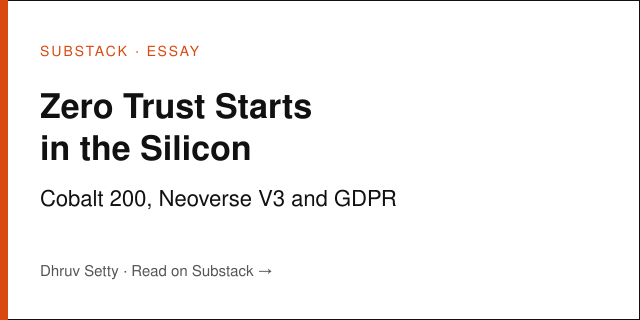

### Dhruv Setty

**IT Support & Identity Administration · Auckland, NZ**

Open to service desk, IT support and IAM/IGA roles in Auckland.

#### About me

Service desk and endpoint administration, built and tested in a home lab. I come from identity-sensitive roles: KYC and AML/CFT checks in retail banking, and patient identity reconciliation under the Health Information Privacy Code. I verify before I change anything, and I am building towards Identity and Access Management (IAM) and Identity Governance and Administration (IGA).

#### Home lab

[bau-home-lab](https://github.com/dhruv-setty/bau-home-lab) holds reproducible lab projects for day to day service desk work, each with a runbook, scripts, evidence and a write-up.

| Project | What it covers | Outcome | Write-up |
| --- | --- | --- | --- |
| [Identity lifecycle](https://github.com/dhruv-setty/bau-home-lab/blob/main/projects/identity-lifecycle/README.md) | Joiner, mover, leaver and password reset on Samba AD in Docker, mapped to Microsoft 365 and Entra ID | Two starters provisioned, one move, one leaver fully offboarded, every change logged to a ticket | [Read](https://github.com/dhruv-setty/bau-home-lab/blob/main/writeups/identity-lifecycle.md) |
| [Intune endpoint compliance](https://github.com/dhruv-setty/bau-home-lab/blob/main/projects/intune/README.md) | Autopilot hash collection, Windows compliance policy and device restrictions profile in Microsoft Graph format, local compliance check | Device remediated from 6 of 8 to 8 of 8 compliant | [Read](https://github.com/dhruv-setty/bau-home-lab/blob/main/writeups/intune-endpoint-compliance.md) |
| [Service desk ticketing](https://github.com/dhruv-setty/bau-home-lab/blob/main/projects/ticketing/README.md) | Incident and request workflows, impact by urgency matrix, P1 to P4 SLAs, escalation, SLA report script | Eight ticket queue scored: six met, one at risk, one breached | [Read](https://github.com/dhruv-setty/bau-home-lab/blob/main/writeups/service-desk-ticketing.md) |
| [CVE-2022-1388 review](https://github.com/dhruv-setty/bau-home-lab/blob/main/cve/CVE-2022-1388-f5-big-ip.md) | F5 BIG-IP authentication bypass: CVSS 3.1 table analysis and remediation | Exposure, impact and fix documented | |

Runbooks: [Microsoft 365](https://github.com/dhruv-setty/bau-home-lab/blob/main/runbooks/m365.md) · [Active Directory](https://github.com/dhruv-setty/bau-home-lab/blob/main/runbooks/active-directory.md) · [Intune](https://github.com/dhruv-setty/bau-home-lab/blob/main/runbooks/intune.md) · [Ticketing](https://github.com/dhruv-setty/bau-home-lab/blob/main/runbooks/ticketing.md) · [Troubleshooting](https://github.com/dhruv-setty/bau-home-lab/blob/main/runbooks/troubleshooting.md)

Tools used: Active Directory, `samba-tool`, Microsoft 365 and Entra ID (mapped), Intune, Windows Autopilot, BitLocker, Defender, Bash, PowerShell, Python, Docker, GitHub Actions.

All lab work runs on local virtual machines and Docker, not in production or a Microsoft 365 tenant. Write-up figures use synthetic fixed data points; the SLA figures are real script output over a sample queue.

  <picture>
    <source media="(prefers-color-scheme: dark)" srcset="assets/skills-hexagon-dark.svg">
    
  </picture>

#### Identity projects

| Project | Objective |
| --- | --- |
| [Entra ID sign in for Debian with SSSD](https://github.com/dhruv-setty/entra-id-sign-in-for-debian-with-sssd) | A C# (.NET 8) command line tool that configures Debian hosts to authenticate Microsoft Entra ID users through the SSSD `idp` provider. |
| [Identity governance for legacy Linux file shares](https://github.com/dhruv-setty/identity-governance-for-legacy-linux-file-shares) | A SailPoint IdentityIQ project that brings POSIX permissions, ACLs and NFSv3 exports on legacy file servers under request, approval and certification. |

#### Publications

  
  
  

#### Research interests

- **Embedded systems engineering.** [Stage 2 translation and TLB maintenance](https://github.com/dhruv-setty/stage-2-translation-and-tlb-maintenance) and [PCIe, DMA and TLB hardware with formal checks](https://github.com/dhruv-setty/pcie-dma-and-tlb-hardware-with-formal-checks) on Arm.
- **Scaling AI chips.** How inference splits across accelerators and edge devices, explored in [Split SPDE-GMRF inference for lane perception](https://github.com/dhruv-setty/split-spde-gmrf-inference-for-lane-perception).

#### Certifications

- Introduction to Cloud Architecture (NZQA micro-credential), Unitec / Te Pūkenga, 2025

#### Elsewhere

  <a href="https://dhruv-setty.github.io">Portfolio</a>
  &nbsp;&nbsp;·&nbsp;&nbsp;
  <a href="https://www.linkedin.com/in/dhruv-setty-nz"> LinkedIn</a>
  &nbsp;&nbsp;·&nbsp;&nbsp;
  <a href="https://substack.com/@dhruvsetty"> Substack</a>
  &nbsp;&nbsp;·&nbsp;&nbsp;
  <a href="https://huggingface.co/itsdhruvsetty"> Hugging Face</a>

